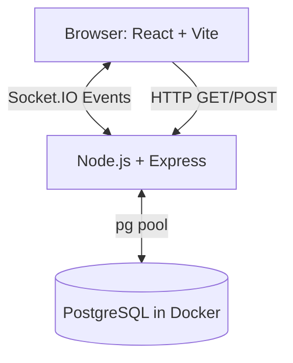

# AptiQuiz: The Placement Pressure Arena

AptiQuiz is a real-time, multiplayer aptitude and logical-reasoning game. It turns boring PDF placement preparation into a high-stakes, 50-player arena race. Built with React, Express, Socket.IO, and PostgreSQL.

## 🚀 The Unique Identity
- **Race Track Leaderboard**: Watch avatars race across the screen as points are scored.
- **Pressure Meter**: A dynamic gauge reflecting the room's collective accuracy and speed.
- **Fairness First**: Sub-millisecond latency compensation so network lag doesn't ruin your placement chances.
- **Anti-Cheat**: Server-authoritative logic. Correct answers are strictly held on the server until the deadline expires.

---

## 🏗️ Architecture & Data Flow


---

## 🛠️ Prerequisites
- **Node.js**: v24 or higher
- **Git**
- **Docker Desktop** (Must be running with WSL2 backend enabled on Windows)

---

## 💻 Local Setup (Windows PowerShell)

1. **Clone & Install**
   ```powershell
   git clone <your-repo-url>
   cd AptiQuiz
   
   # Install root, client, and server dependencies
   npm run install:all
   ```

2. **Environment Configuration**
   ```powershell
   # Copy the example environment variables
   Copy-Item .env.example -Destination .env
   ```

3. **Database Initialization**
   *Ensure Docker Desktop is running before this step.*
   ```powershell
   # Boot up PostgreSQL in the background
   npm run db:up
   
   # Run schema migrations
   npm run migrate
   
   # Seed the database with the sample college and 40 questions
   npm run seed
   ```

4. **Start the Apps**
   ```powershell
   # Starts both Vite (frontend) and Express (backend) concurrently
   npm run dev
   ```

---

## 🧪 Testing & Simulation

### Unit Tests
Run the deterministic scoring and state-machine tests (No DB required):
```powershell
npm run test
```

### 50-Player Simulation
Once the server is running (`npm run dev`), open a new PowerShell tab and run:
```powershell
npm run simulate
```
This spawns 50 headless bots that join a room, measure ping, answer questions, and rigorously test the anti-cheat capacity limits (rejecting the 51st player).

---

## ⚖️ Scoring & Fairness Mechanics

The server is the absolute referee. Your device clock does not matter.
**Score Formula:** `(Base + SpeedBonus + StreakBonus) * Difficulty`
* **Base Points**: 100
* **Speed Bonus**: Up to 50 points, decreasing linearly as time elapses.
* **Streak Bonus**: +10 per consecutive correct answer (capped at 50).
* **Difficulty Multiplier**: Easy (1x), Medium (1.2x), Hard (1.5x).

**Worked Example:**
Medium Question. Answered in 2 seconds out of 10. Streak = 3.
- Base: 100
- Speed: 50 * (1 - (2/10)) = 40
- Streak: 3 * 10 = 30
- Total: (100 + 40 + 30) * 1.2 = **204 points**

**Network Delay Handling:**
The server records a rolling median ping (Round Trip Time) for every player. When an answer is received, the server compensates the elapsed time by subtracting `Ping / 2` (capped at 500ms). There is also a global 250ms grace window after the deadline for packets in transit. Perfect fairness is impossible over the internet, but this neutralizes the most common advantages of physical proximity to the server.

---

## 🔒 Security & Anti-Cheat
- **Zod Validation**: All socket events are strictly type-checked.
- **No Early Reveal**: Explanations and correct options are never sent in the question payload.
- **Session Tokens**: Players receive a secure token hash. Reconnecting restores state seamlessly without creating duplicate players.
- **Limitations**: A highly determined cheater could inspect the DOM to write an auto-clicker. We combat this by rate-limiting events, but client-side automation cannot be completely eradicated without intrusive spyware.

---

## 🐳 Docker Commands & Troubleshooting

- **Check Logs**: `npm run db:logs`
- **Reset DB**: `npm run db:reset` (Destroys data and reseeds)
- **Open psql**: `npm run db:psql`
- **Port 5433 Error**: If port 5433 is taken, edit `.env` and `docker-compose.yml` to use a different `PGPORT`.
- **Docker API Error**: If you see `failed to connect to the docker API`, open Docker Desktop and wait for the green icon.

---

## 🌐 Deployment
- **Client**: Run `npm run build` in `/client`. Deploy the `dist` folder to Vercel, Netlify, or Cloudflare Pages. Ensure `VITE_API_URL` points to your production backend.
- **Server**: A `Dockerfile` is provided in `/server`. Deploy this image to Render, Railway, or Fly.io.
- **Database**: Use a managed PostgreSQL provider (Neon, Supabase). Set `DATABASE_URL` in the server's environment. Run `npm run migrate` as a release command.
